# VOSR2 模型架构与推理流程分析

**目录**

1. 模型简介
2. 整体框架
3. 推理入口（3.1 API · 3.2 张量尺寸）
4. Qwen-Image 2D VAE（4.1 编码器与解码器 · 4.2 后验分布与归一化 · 4.3 AttentionBlock2D）
5. DINOv2
6. LightningDiT（6.1 Block 计算 · 6.2 时间条件 · 6.3 自注意力 · 6.4 交叉注意力 · 6.5 输入/时间/输出层）
7. 推理 Pipeline（7.1 调用时序 · 7.2 Flow Matching · 7.3 时间 schedule · 7.4 多步/单步 · 7.5 颜色对齐）
8. 精度策略与性能优化（8.1 BF16 推理 · 8.2 推理耗时 · 8.3 视频双卡 · 8.4 加速项）
9. 大图推理（9.1 坐标与网格 · 9.2 tile 调度 · 9.3 DINO 对齐 · 9.4 VAE 分块 · 9.5 参数建议）
10. 版本迭代

## 1. 模型简介

VOSR2 是一个以低质图像为条件的潜空间生成式修复模型。它先把输入插值到目标尺寸，再通过 **Qwen-Image 2D VAE 提供结构条件、DINOv2-L 提供空间语义条件、LightningDiT 预测潜空间更新方向**，最后解码并进行可选颜色校正。默认单步推理从高斯噪声直接更新到输出潜变量。

| 组件 | 用途及关键点 | 关键参数 |
| --- | --- | --- |
| Qwen-Image 2D VAE | **用途**：把插值后的 LR 编码成结构 latent，并把生成的 HR latent 解码回 RGB。<br>**Encoder**：`Conv 3→96`，4 个 stage（每 stage 2 个 ResBlock），3 次 stride-2 下采样到 `H/8 × W/8`；Attention 只在 MidBlock；输出 32 通道 posterior（16 均值 + 16 logvar），推理默认取 `mode`。<br>**Decoder**：`post_quant_conv → MidBlock → 3 次 nearest 上采样（每次接卷积）→ RMSNorm2D / SiLU / Conv → clamp[-1,1]`。<br>**关键点**：8× 压缩；逐像素 `RMSNorm2D`、无 GroupNorm → 可分块。 | **结构**：`base_dim=96`、`z_dim=16`、`dim_mult=[1,2,4,4]`、每 stage 2 个 ResBlock<br>**注意力**：`attn_scales=[]`（只在 MidBlock）<br>**潜空间**：8× 压缩、16 通道、16 维 `latents_mean/std`；无时间维 |
| DINOv2 ViT-L/14 | **用途**：提供空间语义条件，作为 36 层 cross-attn 的 K/V。<br>**关键点**：取 `layer_17`；`LayerNorm + MLP` 只投影一次；分块时按 tile 重新提取。 | **结构**：ViT-L/14，24 blocks、width 1024、16 heads、patch 14<br>**输入**：448 → 32×32=1024 个 patch token（去 CLS）<br>**输出**：`layer_17`（第 18 个 block）、1024 维 |
| LightningDiT | **用途**：在 latent 空间预测单步速度 `u`，把噪声 `z₁` 更新为 HR latent。<br>**关键点**：36 层，每层 self-attn → cross-attn → SwiGLU；adaLN 时间调制；QK-Norm + 2D RoPE；单步蒸馏，无 r 分支。 | **输入/输出**：`input_size=64`（512/8）、`patch_size=2`、`in/out=32/16 ch`（16 结构 + 16 噪声 → 16 通道速度）<br>**主干**：`dim=1536`、`depth=36`、`heads=24`（head_dim 64）、`mlp_ratio=4`、SwiGLU hidden 4096<br>**条件**：`z_dims=1024`（DINO 特征）、`encdim_ratio=3`（`mlp_ca` 1024→4608→1536）、`auxiliary_time_cond=false`<br>**开关**：QK-Norm / RMSNorm / 2D RoPE / SwiGLU 全开 |
| 合计 | **用途**：端到端条件单步生成式超分。<br>**关键点**：结构条件 + 语义条件 + 单步 DiT + VAE 解码；无时序模块。 | 128×128 原图 → 4× → 512×512 画布 → VAE 8× → 64×64 latent → patch 2 → 32×32=1024 token<br>DiT 全 36 层保持 1536 维 |

## 2. 整体框架

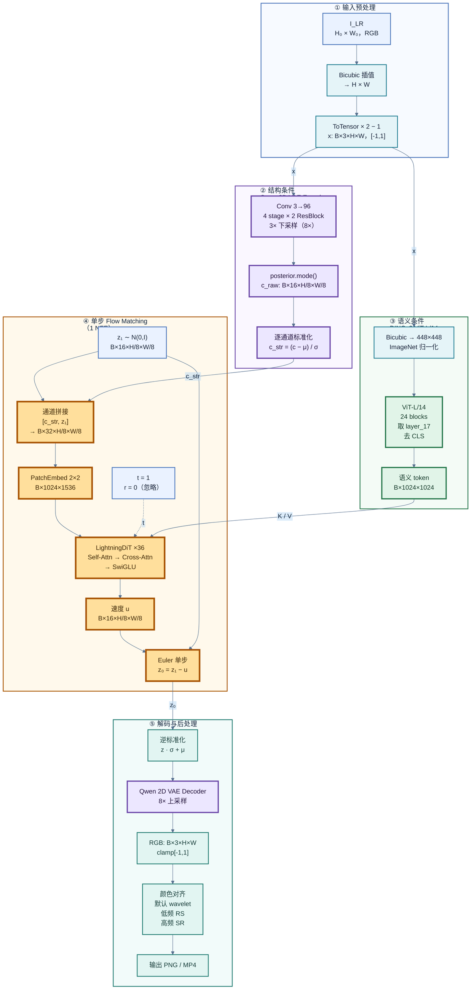

读图要点：

- **① 输入预处理**：`I_LR` 先 Bicubic 到目标画布 `H×W`，再 `ToTensor × 2 − 1` 映射到 `[-1,1]`；放大倍率由这一步决定，模型内部没有 scale embedding。
- **② 结构条件**：VAE 编码一次得到 `16×H/8×W/8`，取 posterior `mode()` 后逐通道标准化；它与 `z` 同空间尺寸。
- **③ 语义条件**：DINO 输入固定 448×448，输出 1024 个 token；与 DiT 的 32×32 图像 token 不是同一网格，只作为 cross-attn 的 K/V。
- **④ 单步生成**：`z₁ ∼ N(0,I)`，`[c_str, z₁]` 拼成 32 通道送入 DiT；`t=1` 查询一次，得到平均速度 `u`（latent 沿时间轴的平均位移速率，不是图像运动），`z₀ = z₁ − u`。
- **⑤ 解码后处理**：逆标准化后 VAE 解码，再做颜色对齐；颜色对齐用输入低频 + 生成高频。
- **大图**：③④ 按 `tile_size=512` 在 latent 网格上循环（DINO 每个 tile 重提），② 的 VAE 编解码可用 `vae_tile_size` 分块（第 9 节）。

当前推理不是直接把原始小图编码成小潜变量，再通过专门的上采样头放大。实际过程为：

```text
x = 2 * ToTensor(Bicubic(I_LR, H, W)) - 1
c_str = NormalizeLatent(E(x))
```

生成潜变量与结构潜变量具有同一空间大小。因此模型解决的是 **目标分辨率画布上的条件生成与细节补全**。放大倍率由入口的 resize 决定，并没有一个单独的“倍率 embedding”。

## 3. 推理入口

> `infer_server.py`

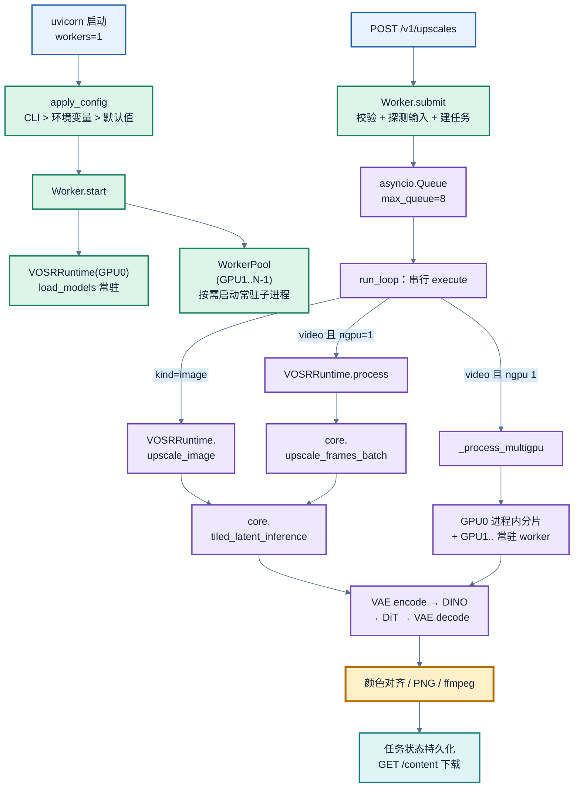

关键对象：

- `VOSRRuntime`：一个 GPU 一份。构造时调用 `core.load_models()`，加载 VAE、DINO、DiT、采样器；`run_args` 由 `args.json` + 服务默认值合成（`infer_steps=1`、`posterior_mode=True`、`align_method=wavelet`、`tile_overlap=32`）。
- `Worker`：持有 `runtimes[0]`、任务字典、`asyncio.Queue`、多卡 worker 池。单进程内**串行**执行，避免并发采样打爆显存。
- `WorkerPool`：GPU1..N-1 的常驻子进程，模型只加载一次；`num_gpus` 不变时跨请求复用。

### 3.1 API

| 方法 | 路径 | 作用 |
| --- | --- | --- |
| `GET` | `/health` | 健康检查（含显卡、dtype、队列、鉴权开关） |
| `GET` | `/v1/models`、`/v1/models/{id}` | 返回 `VOSR2-1.4B-OneStep` |
| `POST` | `/v1/files` | 上传图片/视频，返回 `file_id` |
| `GET` / `DELETE` | `/v1/files`、`/v1/files/{id}` | 列出/删除上传文件 |
| `POST` | `/v1/upscales` | 提交任务；按扩展名自动识别 image/video；返回 `202` |
| `GET` | `/v1/upscales`、`/v1/upscales/{id}` | 列表/查询进度与结果 |
| `POST` | `/v1/upscales/{id}/cancel` | 取消（batch 边界生效） |
| `GET` | `/v1/upscales/{id}/content` | 下载 PNG / MP4 |


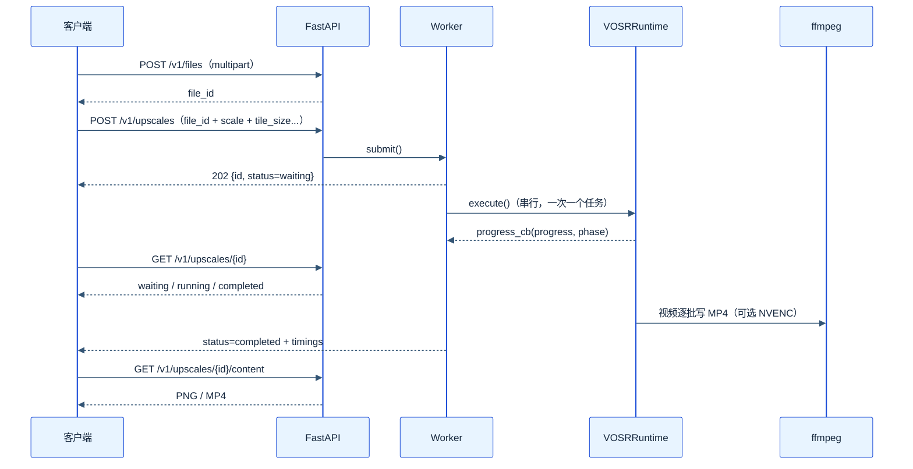


### 3.2 张量尺寸

下表以 **128×128 输入、4× 放大到 512×512** 为例分析各阶段数据张量尺寸信息。

| 阶段 | 张量 | 尺寸 | 含义 |
| --- | --- | --- | --- |
| 原始输入 | `I_LR` | `B×3×128×128` | 低质原图，RGB；示例为 128×128 |
| 插值后输入 | `lq` / `x` | `B×3×512×512` | Bicubic 4× 到目标画布，再映射到 `[-1,1]` |
| VAE 编码分布 | moments | `B×32×64×64` | 16 通道均值和 16 通道 log-variance；`64×64 = 512/8` |
| 结构潜变量 | `lq_latent` | `B×16×64×64` | 默认取 posterior mode，再逐通道归一化 |
| 初始噪声 | sampler 中的 `z` | `B×16×64×64` | 独立高斯噪声，区别于 DiT 参数名 `z` |
| DiT 输入 | `cat([lq_latent,z],1)` | `B×32×64×64` | 前 16 通道结构，后 16 通道噪声状态 |
| latent patch | 2×2 patch | 每 token 128 个输入值 | `32×2×2=128` 个输入值 / token；`64×64` latent → `32×32` 个 patch |
| PatchEmbed | `x` | `B×1024×1536` | token 网格 `32×32=1024`（`64/2`） |
| DINO 输入 | normalized RGB | `B×3×448×448` | 与 DiT token 网格尺寸不是同一个概念 |
| DINO 中间层 | semantic tokens | `B×1024×1024` | `448/14=32`，去掉 CLS |
| 语义投影 | `mlp_ca(z)` | `B×1024×1536` | 共享一次投影，供全部 block 使用 |
| 时间编码 | `c` | `B×1536` | VOSR2 只使用 `t_embedder(t)` |
| 时间调制 | `c0` | `B×9216` | `6×1536`，每层再加自己的参数表 |
| 自注意力 Q/K/V | 分头后 | `B×24×1024×64` | 每头维度 `1536/24=64` |
| 36 层 block 输出 | `x` | `B×1024×1536` | token 数不变 |
| 最终线性层 | patch velocity | `B×1024×64` | `2×2×16=64` |
| unpatchify | `u` | `B×16×64×64` | 预测潜空间更新方向；`64×64 = 512/8` |
| VAE 解码 | `sr_tensor` | `B×3×512×512` | RGB，裁剪到 `[-1,1]` |

```mermaid
%%{init: {"theme":"base","flowchart":{"htmlLabels":false},"themeVariables":{"background":"#FFFFFF","primaryColor":"#EAF8F0","primaryTextColor":"#14263D","primaryBorderColor":"#087F5B","secondaryColor":"#BDE8D0","secondaryTextColor":"#14263D","tertiaryColor":"#F8FAFC","tertiaryTextColor":"#14263D","lineColor":"#57708F","textColor":"#14263D","actorBkg":"#EAF8F0","actorBorder":"#087F5B","actorTextColor":"#14263D","signalColor":"#335575","fontFamily":"Arial, Noto Sans CJK SC, sans-serif","fontSize":"16px"}}}%%
flowchart LR
    A["插值后 RGB<br/>3 × 512 × 512"] --> B["VAE<br/>16 × 64 × 64"]
    B --> C["与噪声拼接<br/>32 × 64 × 64"]
    C --> D["PatchEmbed 2 × 2<br/>1024 × 1536"]
    D --> E["36 个 DiT Block<br/>1024 × 1536"]
    E --> F["Final Linear<br/>1024 × 64"]
    F --> G["Unpatchify<br/>16 × 64 × 64"]
    G --> H["积分与 VAE 解码<br/>3 × 512 × 512"]
    %% STYLE_START
    classDef input fill:#E8F1FF,stroke:#2563A6,stroke-width:2px,color:#17233A;
    classDef condition fill:#DDF5E9,stroke:#18805B,stroke-width:2px,color:#17233A;
    classDef model fill:#EEE8FF,stroke:#7045B5,stroke-width:2px,color:#17233A;
    classDef key fill:#FFF0C9,stroke:#B36B00,stroke-width:3px,color:#17233A;
    classDef output fill:#DFF4F5,stroke:#157D86,stroke-width:2px,color:#17233A;
    classDef warning fill:#FFE7E7,stroke:#B73B46,stroke-width:2.5px,color:#17233A;
    class A input;
    class B,C condition;
    class D,E,F,G model;
    class E key;
    class H output;
    %% STYLE_END
```

## 4. Qwen-Image 2D VAE

同一个 VAE 潜空间用于低质结构条件和高质图像表示。训练时编码 LR/HR 两种图像；推理时编码插值后的 LR，生成器预测最终 HR 潜变量，再经解码器输出图像。DiT 不接收 VAE 编码器的多尺度 skip features，因此这不是一个带 LR 像素跳连的 U-Net 修复器。

VAE 配置：`base_dim=96`、`z_dim=16`、`dim_mult=[1,2,4,4]`、每个 encoder stage 两个 residual block，总参数 44.6M（FP32，178 MB），空间压缩 8×，**没有时间维卷积**。

### 4.1 编码器与解码器

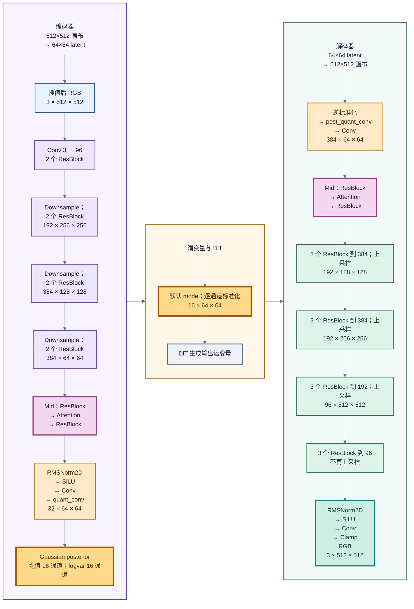

`ResidualBlock2D` 使用两次 `RMSNorm2D → SiLU → 3×3 Conv`，第二次卷积前有 dropout，通道不同时用 1×1 shortcut。下采样用右/下补零后 stride-2 卷积；上采样用 nearest interpolation，再用卷积把通道减半。没有时间卷积、跨帧 cache 或时序注意力。

两个容易误读的实现细节：

- `RMSNorm2D` 的归一化维是**通道维**：`F.normalize(x, dim=1) * sqrt(C) * gamma + bias`，即逐像素对 C 个通道做 L2 归一化并乘 `sqrt(C)`，而不是沿空间/通道联合统计的 GroupNorm。因此每个像素独立，**没有跨 tile 的统计量需要对齐**，这是 VAE 分块在数学上成立的前提。
- 编码器/解码器的 `attn_scales=[]`，因此 **Attention 只出现在 MidBlock**，不在各个分辨率 stage 里。解码器最后 `torch.clamp(dec, -1, 1)`。

### 4.2 后验分布与潜变量归一化

对插值后的输入图像编码得到高斯分布：

```text
q(z | x) = Normal(mu_phi(x), diag(sigma_phi(x)^2))
```

编码器最后一个卷积输出的是 **32 通道**张量，而 `DiagonalGaussianDistribution` 会把它按通道切成 **16 维 mean + 16 维 logvar**。`quant_conv` 就插在这两者之间：

```python
h = self.encoder(x)          # B×32×H/8×W/8
h = self.quant_conv(h)       # 32→32，1×1 Conv
posterior = DiagonalGaussianDistribution(h)
# mean, logvar = chunk(h, 2, dim=1)
```

它的作用是对 32 个通道做一次**逐像素的线性混合**（1×1 卷积等价于每个像素一个 32→32 的全连接层），让网络自己学习怎样把编码器特征组织成更适合作为 mean/logvar 的参数，而不是硬性依赖最后一层卷积直接输出“前 16 个是均值、后 16 个是方差”。它不做任何离散化/查表，名字沿用 Stable Diffusion 的 `quant_conv`；参数量只有 `32×32 + 32 = 1056`。

解码端有一个对称的 `post_quant_conv`（16→16，1×1 Conv），把逆标准化后的 latent 先投影到 decoder 的输入空间：

```text
编码：encoder → quant_conv → posterior.mode() → (z − μ_cfg) / σ_cfg
解码：z · σ_cfg + μ_cfg → post_quant_conv → decoder
```

1×1 卷积只混合通道、不混合空间邻域，所以不改变 `H/8 × W/8` 的网格，也不影响 VAE 分块。

默认推理用 `latent_dist.mode()`，即取后验分布的均值；训练脚本用 `posterior.sample()`。这里有两套完全不同的“均值/标准差”，先分开看：

| 名称 | 谁产生 | 形状 | 作用 |
| --- | --- | --- | --- |
| posterior 的 `mean` / `logvar` | 编码器对**每张图**预测 | 各 16 通道 | 定义后验 `q(z; x)`，供 `mode()` / `sample()` 使用 |
| `config.latents_mean`（记作 `m_cfg`） | 训练集统计，固定 | 16 维向量 | 把 VAE latent 平移到 DiT 的工作空间 |
| `config.latents_std`（记作 `σ_cfg`） | 训练集统计，固定 | 16 维向量 | 把各通道缩放到相近尺度 |

第一套描述“这张图的内容分布”，第二套是“整个 latent 空间的坐标变换”；真正送进 DiT 的是经过第二套变换的 `z_norm`。

**前向（encode）**：

```text
z_raw  = posterior.mode()              
z_norm = (z_raw - m_cfg) / σ_cfg       # 进入 DiT 的 latent
```

**逆向（decode）**：

```text
z_raw = z_norm * σ_cfg + m_cfg         # 回到 VAE 解码器
```


### 4.3 AttentionBlock2D

`AttentionBlock2D` 在低分辨率特征上执行 **单头全局自注意力**：1×1 卷积产生 Q/K/V，空间展平成 `N=H'W'`，通过 PyTorch SDPA，投影后残差相加。

```python
q, k, v = qkv.unbind(dim=1)
x_attn = F.scaled_dot_product_attention(q[:, None], k[:, None], v[:, None])
x_attn = x_attn.squeeze(1)
```

这里刻意使用 4D 的 `(B, 1, N, C)` 形状：同样的数学结果，但会命中 Flash / memory-efficient kernel，显存为 `O(N)`；如果写成 3D `(B, N, C)`，某些后端会退回数学实现，显存变 `O(N²)`，大图直接 OOM。这是仓库标注的“O(N)-memory VAE attention”改动。

朴素实现会显式生成 `scores = q @ k^T` 和 `softmax(scores)`，每个都是 `N×N`，显存 `O(N²)`。

Flash / memory-efficient SDPA 把 Q 分块，对 K/V 做 **online softmax**，只保留 `O(N)` 的 Q/K/V/输出和 `O(block)` 的临时缓冲，不落地完整 `N×N`。但每个 Q 仍要和所有 K 做点积，所以**计算量仍是 `O(N²)`**。

这里的 `O(N)` 只指 attention 的激活显存；VAE 的卷积激活仍随 `H×W×C` 增长，所以高分辨率仍需 `vae_tile_size` 限制单次 `N`。

## 5. DINOv2

**作用**

- **语义条件编码器**：把输入图像（或分块后的 tile）编码成一组空间语义 token，作为 LightningDiT 36 层 cross-attention 的 K/V；它不参与 VAE 潜空间的编解码，也不是生成主干。
- **分工**：
  - VAE latent：低层结构与颜色
  - DINO：内容、文字、物体的语义先验
  - 两者互补，共同作为 DiT 的条件。
- **为什么用 DINOv2**：取它的**稠密 patch token**（32×32），保留空间对应关系；不是只取全局 CLS 向量。
- **只做条件编码**：直接使用 `dinov2_vitl14` 的预训练特征，不向 DiT 传像素 skip。

**关键细节**

- **输入**：统一缩放到 448×448 并做 ImageNet 标准化；ViT-L/14、patch 14 → 32×32 = 1024 个 token（去掉 CLS）。
- **取层**：`layer_17`（第 18 个 block，0-indexed），在语义强度与空间细节之间折中，而不是最后一层。
- **投影**：`LayerNorm(1024) + mlp_ca(1024→4608→1536)` 只执行一次，36 层共享；每层 cross-attn 另有自己的 K/V 线性层。
- **网格对应**：默认 512 tile 下，DINO 的 32×32 与 DiT 的 32×32 图像 token 恰好同网格；tile 改为 1024 时 DINO 仍固定 32×32，二者不再逐格对应。
- **分块**：每个 tile 单独跑一次 DINO，语义视野与 DiT tile 对齐；整图路径则对整图缩放到 448。

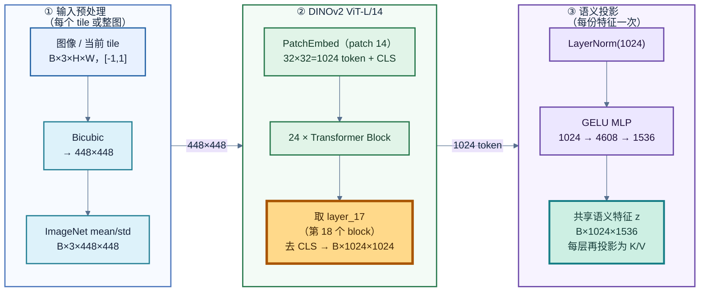

## 6. LightningDiT

**作用**

- **生成主干**：接收 `[c_str, z_t]`（32 通道）、时间 `t` 和 DINO 语义 token，输出 latent 空间的速度 `u`（16 通道）。像素编解码交给 VAE，语义由 DINO 提供，DiT 只负责条件生成。
- **单步**：VOSR2 只在 `t=1` 查询一次（时间维 1 NFE；空间上每个 tile 各一次前向），无 CFG、无 r 分支；一次时间步把噪声更新为 HR latent。
- **规模**：36 层、1536 维、24 头；36 层合计约 1.36B 参数（占 1.394B 的 97%），是绝对主力。

**关键细节**

- **输入输出**：`[c_str, z_t]` → PatchEmbed 2×2 → `32×32=1024` token → 36 blocks → Final Linear `1024×64` → unpatchify `16×64×64`。
- **Block 顺序**：adaLN 时间调制 → Self-Attn（QK RMSNorm + 2D RoPE + SDPA）→ Cross-Attn（Q 来自图像，K/V 来自 DINO）→ SwiGLU FFN；全部残差。
- **时间条件**：`t → t_embedder → c`，`c → t_block → c0`（6×1536）；每个 block 再叠加自己的 `scale_shift_table`。
- **语义入口**：DINO token 先共享投影到 1536，每层 cross-attn 再各自投影 K/V；cross-attn 没有 RoPE。
- **感受野与分块**：Self-Attn 只在本 tile 的 1024 token 内，不做跨 tile / 跨帧注意力；每个 512 tile 是 64×64 latent，逐 tile 前向，全局 `z` 状态共享。

### 6.1 Block 计算

单层 Block 的数据流：`x`、共享的 `c0`、DINO 语义 `z` → 时间调制 → Self-Attn → Cross-Attn → FFN → 更新后的 `x`。

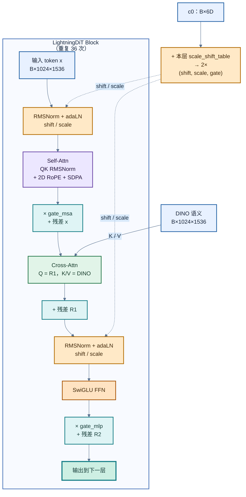

对应上面的流程图，一个 Block 的前向可以拆成四步：**生成调制参数 → Self-Attn → Cross-Attn → FFN**。核心代码只有十几行：

```python
# c 是共享的 c0：B×9216；scale_shift_table 是每层独立的 6×1536
# 1) 时间调制：相加后按 6 个 chunk 拆成两条分支的 (shift, scale, gate)
shift_msa, scale_msa, gate_msa, shift_mlp, scale_mlp, gate_mlp = (
    self.scale_shift_table[None] + c.reshape(B, 6, -1)   # B×6×1536
).chunk(6, dim=1)

# 2) Self-Attn：RMSNorm → adaLN 调制 → QK-Norm + 2D RoPE → SDPA
x = x + gate_msa * self.attn(
    modulate_adasin(self.norm1(x), shift_msa, scale_msa), rope=feat_rope
)

# 3) Cross-Attn：Q 来自图像 token x，K/V 来自 DINO 语义 z
if self.z_dims is not None:          # VOSR2 恒为 True
    x = x + self.cross_attn(x, z)

# 4) FFN：RMSNorm → adaLN 调制 → SwiGLU，再乘 gate 残差
x = x + gate_mlp * self.mlp(
    modulate_adasin(self.norm2(x), shift_mlp, scale_mlp)
)
```

形状（512 tile）：`x`、`z` 都是 `B×1024×1536`；`c` 是 `B×9216`；6 个调制量各为 `B×1×1536`，依靠广播作用到每个 token。

把上面的代码写成公式，令 `s,a,g` 分别为 shift、scale、gate，`c_sem'` 为已投影的语义：

```text
x_1 = x   + g_A * SA((1 + a_A) * RMSNorm(x)   + s_A)
x_2 = x_1 + CA(x_1, c_sem')
x_3 = x_2 + g_F * SwiGLU((1 + a_F) * RMSNorm(x_2) + s_F)
```

三项分别对应：

- `x_1`：Self-Attn 分支。先 `RMSNorm`，再用 `(1 + a_A)` 缩放、`s_A` 平移，过自注意力后乘 gate `g_A` 加回 `x`。
- `x_2`：Cross-Attn 分支。Q 来自 `x_1`，K/V 来自 DINO 语义 `c_sem'`，再残差加回。
- `x_3`：FFN 分支。同样的 adaLN 调制后过 SwiGLU，乘 gate `g_F` 加回。

也就是说，每层只在残差上学习“增量”；`s / a / g` 都由时间条件生成。代码中的 `modulate_adasin(x, shift, scale)` 就是 `x * (1 + scale) + shift`，调用前先做 `RMSNorm`，与上面的公式一一对应。

### 6.2 时间条件

`t_embedder` 先把标量 `t` 编码成 1536 维向量 `c`；`t_block` 再把 `c` 映射成 6×1536 的 `c0`。`c0` 由 36 层共享，每层只叠加自己的 `scale_shift_table`：

```python
c  = self.t_embedder(t)          # B×1536：正弦时间编码 + 2 层 MLP
c0 = self.t_block(c)             # B×9216：SiLU + Linear(1536 → 6×1536)

# 每个 block 内部（形参 c 即上面的 c0）：
mod = self.scale_shift_table[None] + c.reshape(B, 6, -1)   # B×6×1536
shift_msa, scale_msa, gate_msa, shift_mlp, scale_mlp, gate_mlp = mod.chunk(6, dim=1)
```

- `c0` 是**所有 block 共享**的时间向量；`scale_shift_table` 是**每层独立**的可学习偏置。
- 6 个 chunk 正好对应两条分支的 `(shift, scale, gate)`：MSA 一组、MLP 一组。
- `final_layer` 用的是 `c`（不是 `c0`），再走自己的 `adaLN_modulation` 得到最终 shift/scale。

**关于 r / r_embedder**

Shortcut / 一致性蒸馏会额外传入一个“目标终点时间” `r`，让模型学习从 `t` 一步跳到 `r`。代码里对应的就是 `r_embedder`：

```python
# 仅当 auxiliary_time_cond=True 时存在
r_emb = self.r_embedder(r) * (t - r).unsqueeze(-1)
c = c + r_emb
```

- `t = r` 时 `(t − r) = 0`，表示不跳；
- `r < t` 时表示“提前跳到终点”；
- VOSR2 的 `auxiliary_time_cond=false`，`r_embedder=None`，所以 `r` 被忽略，`c` 只由 `t` 决定。

这也是 VOSR2 只做固定 `t=1 → 0` 单步、不需要端点条件的原因（细节见 7.3）。

### 6.3 自注意力

每个 token 先线性产生 Q/K/V，分成 24 个头，每头 64 维。Q/K 各自经过 RMSNorm；随后只对 Q/K 施加二维 RoPE，V 不旋转。其核心为：

```text
Q' = RoPE_2D(RMSNorm(Q))
K' = RoPE_2D(RMSNorm(K))
A  = softmax((Q' @ K'^T) / sqrt(64)) @ V
```

二维 RoPE 将每头的 64 维分配给高/宽两个方向；每个方向 32 维。训练网格为 `32×32`，固定频率表大小为 `1024×64`。`forward_flexible()` 在输入空间尺寸改变时重建频率，把当前坐标按 `current_grid` 缩放回训练坐标范围：

```text
p_i = (i / G_current) * G_train
```

这实现了尺寸适配，不代表模型已经学习所有分辨率的统计。它也没有把注意力替换成局部窗口注意力。

`VisionRotaryEmbeddingFast.forward` 每次调用都会 `freqs_cos.clone().to(t.dtype)`，并用 `@torch.compiler.disable` 排除出编译图；36 层每层执行一次。

### 6.4 交叉注意力

交叉注意力的 Q 来自图像 token，K/V 来自投影后的 DINO token。每层分别有 `q_linear/k_linear/v_linear/proj`，Q/K 使用 RMSNorm；没有额外的 RoPE。设图像 token 数为 N、语义 token 数为 M：

```text
CA(X, S) = W_O[softmax((Norm(X @ W_Q) @ Norm(S @ W_K)^T) / sqrt(d_h))
                 @ (S @ W_V)]
```

### 6.5 输入、时间与输出层

| 层 | 实现 | 作用 |
| --- | --- | --- |
| `x_embedder` | timm `PatchEmbed`，Conv `32→1536`，kernel/stride=2，`strict_img_size=False` | `[lq,z]` 的 2×2 patch → 1024 token |
| `t_embedder` | 256 维正弦频率（fp32 计算）→ Linear 256→1536 → SiLU → Linear 1536→1536 | 时间条件 `c` |
| `t_block` | SiLU → Linear 1536→9216 | 共享 6D 调制向量 `c0` |
| `final_layer` | adaLN（SiLU→Linear 1536→3072）→ RMSNorm → Linear 1536→64 | 每个 token 输出 2×2×16 的 velocity |
| `unpatchify` | `einsum('nhwpqc->nchpwq')` | `B×1024×64 → B×16×64×64` |

`unpatchify` 用 `h = w = sqrt(N)` 还原，因此**要求 token 网格是方形**。这正是 `SquarePadDiT` 存在的原因：整图非方形时先 reflect-pad 成方形，跑完再裁回；分块路径因为每个 tile 天然是 64×64 latent，不需要 pad。

## 7. 推理 Pipeline

> 原生权重为 `FP32`。默认服务对 DiT 和 DINO 使用 BF16，VAE 保持 FP32（第 8 节）。

### 7.1 调用时序

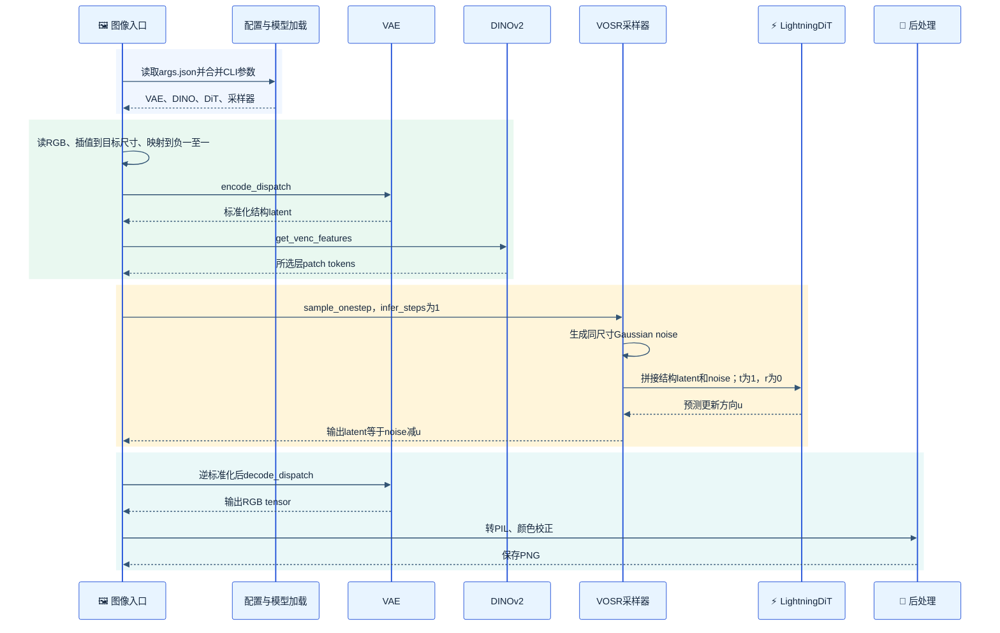

时序图画的是整图路径；分块路径会在 DiT 前向阶段遍历 tiles。`sample_onestep` 调用时把 `t_next` 也传进了 `r` 形参，但 VOSR2 的 `r_embedder` 是 `None`，该参数被忽略，不影响结果。

### 7.2 训练目标：Flow Matching

训练位于 [vosr.py](vosr.py#L141) 的 `loss_fm`。对每个样本采样一个噪声等级 `t ∈ (0,1)`：

```text
z_t = (1 - t) * hq + t * eps          # t=0 干净，t=1 纯噪声
v   = eps - hq                        # 目标速度（恒定）
loss = || model([lq_mixed, z_t], t) - v ||^2
```

- `t=0` 时 `z_t=hq`，`t=1` 时 `z_t=eps`；因此 `t` 是**噪声等级**，方向与常见“t=0 是噪声”的约定相反。
- 因为 `z_t` 是 `hq` 与 `eps` 的线性插值，真实速度沿整条路径恒定，`v = eps - hq` 与 `t` 无关。
- VOSR2 的时间分布是 `lognorm [mu=0, sigma=1]`：`t = sigmoid(N(0,1))`，关于 0.5 对称，在接近 0 和接近 1 的两端也有不小概率。
- `cfg_ratio=0.1`：训练时 10% 样本把结构条件换成弱条件（`lq_weak`、`z=0`），使教师可以用 CFG；单步学生推理时不再做 CFG。
- `cond_strength_aelq` 还会对 `lq` 做插值/球面加噪，模拟不同程度的低质输入。

### 7.3 时间 schedule 与单步积分

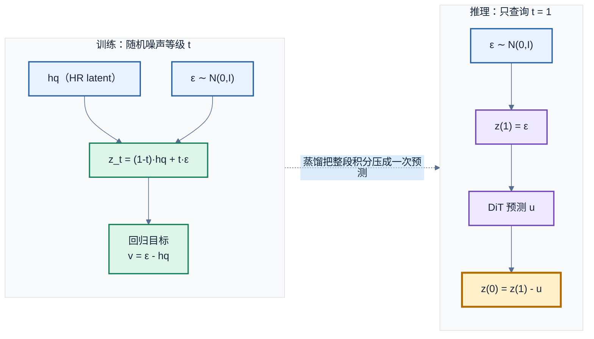

采样端（[vosr.py](vosr.py#L279)）的 `sample_onestep`：

```python
t_seq = torch.linspace(1., 0., n_steps + 1)      # n_steps=1 -> [1, 0]
for i in range(n_steps):
    u = model(torch.cat([lq, z], 1), t_cur.repeat(B), t_next.repeat(B), venc_fea)
    z = z - (t_cur - t_next) * u
return z
```

`n_steps=1` 时 `dt=1`，即：

```text
u_θ = model_θ([c_str, z_1], t=1, c_sem)
z_0 = z_1 - u_θ
```

关键点：这里的 `u` **不是 t=1 处的瞬时速度**，而是模型被蒸馏去逼近的**整段平均速度**。先把“速度”说清楚：`v = dz_t/dt` 是 **latent 空间的速度场**，每个元素表示某个位置/通道的数值沿时间 `t` 的位移速率；它不是图像里的物体运动或光流。模型输出与 latent 同形状（`B×16×H/8×W/8`），预测的是“每个位置、每个通道往哪个方向走、走多快”。

```text
u_θ(z_1, c) ≈ ∫_0^1 v(z_t, t, c) dt
```

因此一次 Euler 步在构造上就是精确的（前提是 `u` 学得准）。蒸馏损失正是为此设计的：

- Shortcut：`u_loss` 用两段中点积分 `(v1+v2)/2` 作为 `u` 的目标；
- RCGM：在 `[r, t]` 上再走 `RCGM_N` 步，构造一致性目标 `F_t`，并让 `u` 匹配它。

`r` 是 Shortcut / 一致性蒸馏中的**辅助终点时间**：模型被要求学会从当前 `t` 一步跳到 `r`（`r ≤ t`）。`r_embedder` 就是把 `r` 编码成向量，并按 `r_embedder(r) · (t − r)` 加到时间条件 `c` 上；`t = r` 时该项为 0，`r < t` 时表示“提前跳到终点”。VOSR2 的 `auxiliary_time_cond=false`，这个 embedder 为 `None`，`r` 被完全忽略——它只做固定的 `t=1 → 0`，不需要端点条件；这也是它区别于首发 `1.4B-os` 的结构点。

### 7.4 多步与单步采样对比

| 项目 | 首发多步路径 | 单步路径 VOSR2 |
| --- | --- | --- |
| 方法 | `sample_multistep_fm` | `sample_onestep` |
| DiT 前向次数（NFE） | 25；CFG 窗口内 batch×2，计算量约 50× | **1** |
| 初始状态 | Gaussian latent noise | Gaussian latent noise |
| 时间序列 | 默认线性，从 1 到 0 | 默认线性；1 步就是 `[1,0]` |
| 每步模型输入 | 强条件；窗口内再拼弱条件 batch | 条件输入 |
| 在线 CFG | 有 | 无 |
| 是否使用 `cfg_scale` 做预测组合 | 是 | 否 |
| 辅助终点时间 r | 无 | 无（`r_embedder=None`） |
| 每步更新 | `z -= dt * v_guide` | `z -= dt * u` |

`scheduler` 参数支持 `linear` 与 `cosine`，但在 `n_steps=1` 时两者都退化为 `[1,0]`，没有区别。`infer_steps>1` 虽然接口可跑，但会把“单步蒸馏模型”当成多步模型重复调用，不属于训练分布，不建议用于生产。

### 7.5 颜色对齐

默认名称为 `wavelet` 的函数，当前实际实现用 Gaussian blur 分离低频/高频，`sigma=5`：

```text
I_out = clip(G_sigma(I_input) + I_SR - G_sigma(I_SR), 0, 1)
```

也就是用输入的低频颜色，保留生成结果的高频细节；它没有在该函数里执行显式小波滤波器组分解。`adain` 则按 RGB 通道匹配输出与输入的均值/标准差；`nofix` 跳过颜色对齐。

`source` 会先 `resize` 到输出尺寸（LANCZOS）再取低频，因此颜色对齐与倍率无关。

## 8. 精度策略与性能优化

### 8.1 BF16 推理

仓库发布的 VOSR2 权重是**纯 FP32**，推理速度较慢。可优化为**BF16**推理。

服务入口默认 `--dtype bf16`。它不是 `torch.autocast`，而是**显式把 DiT 和 DINOv2 的权重整体转成 BF16**，VAE 保持 FP32：

```python
run_dtype = torch.bfloat16 if args.dtype == 'bf16' else torch.float32
if run_dtype == torch.bfloat16:
    venc.to(dtype=run_dtype)
    model.to(dtype=run_dtype)
```

```mermaid
%%{init: {"theme":"base","flowchart":{"htmlLabels":false},"themeVariables":{"background":"#FFFFFF","primaryColor":"#E8F4FF","primaryTextColor":"#14263D","primaryBorderColor":"#1D4ED8","secondaryColor":"#B9D9F5","secondaryTextColor":"#14263D","tertiaryColor":"#F8FAFC","tertiaryTextColor":"#14263D","lineColor":"#57708F","textColor":"#14263D","actorBkg":"#E8F4FF","actorBorder":"#1D4ED8","actorTextColor":"#14263D","signalColor":"#335575","fontFamily":"Arial, Noto Sans CJK SC, sans-serif","fontSize":"16px"}}}%%
flowchart LR
    IMG["RGB 输入<br/>FP32"] --> VAE["Qwen VAE Encoder<br/>FP32"]
    VAE --> LAT["lq_latent<br/>FP32"]
    LAT --> C1["cast → BF16"]
    IMG --> DINO["DINOv2-L<br/>BF16"]
    C1 --> DIT["LightningDiT<br/>BF16"]
    DINO --> DIT
    DIT --> SR["sr_latent<br/>BF16"]
    SR --> UP["÷ std + mean<br/>FP32 张量触发类型提升"]
    UP --> DEC["Qwen VAE Decoder<br/>FP32"]
    DEC --> OUT["RGB<br/>FP32"]
    %% STYLE_START
    classDef input fill:#E8F1FF,stroke:#2563A6,stroke-width:2px,color:#17233A;
    classDef condition fill:#DDF5E9,stroke:#18805B,stroke-width:2px,color:#17233A;
    classDef model fill:#EEE8FF,stroke:#7045B5,stroke-width:2px,color:#17233A;
    classDef key fill:#FFF0C9,stroke:#B36B00,stroke-width:3px,color:#17233A;
    classDef output fill:#DFF4F5,stroke:#157D86,stroke-width:2px,color:#17233A;
    classDef warning fill:#FFE7E7,stroke:#B73B46,stroke-width:2.5px,color:#17233A;
    class IMG input;
    class VAE,LAT,DINO condition;
    class C1,DIT,SR,UP model;
    class DEC key;
    class OUT output;
    %% STYLE_END
```

为了保证“只转权重也能跑对”，代码在几处做了显式处理：

1. **输入边界 cast**：`lq_latent.to(model_dtype)`、`z_fea = [f.to(model_dtype)]`、DINO 输入 `raw_image_.to(venc_dtype)`。
2. **TimestepEmbedder 内部 FP32 消除**：正弦频率 `t_freq` 在 FP32 下构造，进入 MLP 前显式 `.to(self.mlp[0].weight.dtype)`（[lightningdit.py:213](models/lightningdit.py#L213)）。否则会出现 `F.linear(bf16_weight, fp32_input)` 的 dtype 不匹配——这正是很多实现必须依赖 `autocast` 的原因。
3. **RMSNorm 内部保留 FP32 累加**：`RMSNorm.forward` 执行 `x.float()` 归一化后再 `.type_as(x)`，即计算在 FP32、输出回 BF16。QK-Norm 同样是这个实现，保证注意力前的数值稳定。
4. **RoPE 表按输入 dtype 取用**：`freqs_cos/sin` 是 buffer，模型转 BF16 后也变 BF16，`forward` 里再 `.to(t.dtype)`。
5. **VAE 自动回到 FP32**：`sr_latent` 是 BF16，但 `latents_std` / `latents_mean` 是 FP32 张量，`sr_latent / latents_std + latents_mean` 触发 PyTorch 类型提升，VAE decoder 收到的就是 FP32；VAE 权重本身也从未转换。
6. **噪声 dtype**：视频路径先用 FP32 CPU generator 生成再 cast 到模型 dtype（`_batch_noise`），保证逐帧 seed 可复现；图片服务的整图/分块路径都用 `torch.randn_like(lq_latent)`，按当前 dtype 直接生成。


**为什么 VAE 不转 BF16**：

1. VAE 负责最终像素重建，BF16 只有 8 位尾数，颜色/纹理上的舍入更容易被肉眼看到；DiT 输出的是速度场，后续还有积分与解码，容错更高。
2. VAE 是卷积 + 逐像素归一化，计算密度低于 DiT 的大矩阵乘，Tensor Core 带来的收益相对小。
3. VAE 只有 44.6M 参数（0.18 GB），转 BF16 省不下多少显存。

代价是 VAE 的固定开销会摊薄端到端加速比；本次实测中，batch 大的视频收益（约 3×）明显高于单图（约 2×），见 8.2。

### 8.2 推理耗时

> - NV H800
> - 图片：2×：tile_size=512; 4×：tile_size=512,vae_tile_size=1024
> - 视频：2× / 4x：tile_size=512, vae_tile_size=1024
> - 预热

| 输入 | 缩放倍数 | 目标尺寸 | tiles | dtype | 中位耗时 | s/帧 | 峰值显存 | 激活峰值 | 相对 FP32 |
| --- | --- | --- | --- | --- | --- | --- | --- | --- | --- |
| 图像 768×768 | 2× | 1536×1536 | 16 | FP32 | 2.278s | — | 11.72 GB | 5.14 GB | 1.00× |
| 图像 768×768 | 2× | 1536×1536 | 16 | BF16 | **0.976s** | — | **8.52 GB** | 5.10 GB | **2.33×** |
| 图像 768×768 | 4× | 3072×3072 | 49 | FP32 | 7.815s | — | 9.45 GB | 2.71 GB | 1.00× |
| 图像 768×768 | 4× | 3072×3072 | 49 | BF16 | **3.898s** | — | **6.17 GB** | 2.59 GB | **2.00×** |
| 视频 1280×720（8 帧） | 2× | 2560×1440 | 24 | FP32 | 23.159s | 2.895 | 29.85 GB | 22.64 GB | 1.00× |
| 视频 1280×720（8 帧） | 2× | 2560×1440 | 24 | BF16 | **7.306s** | **0.913** | **26.25 GB** | 22.21 GB | **3.17×** |
| 视频 1280×720（4 帧） | 4× | 5120×2880 | 84 | FP32 | 43.473s | 10.868 | 21.31 GB | 13.41 GB | 1.00× |
| 视频 1280×720（4 帧） | 4× | 5120×2880 | 84 | BF16 | **14.896s** | **3.724** | **17.38 GB** | 12.65 GB | **2.92×** |

读法：

- **BF16 单卡加速 2.0–3.2×**。视频（batch 8 / 4）比单图（batch 1）更接近 Tensor Core 的甜蜜点，因此收益更高；图像 4× 只有 2.0×，因为 49 个 tile 的 DiT 计算与固定 VAE 开销都被摊在 batch=1 上。
- **显存收益主要来自权重**：实测 `weights + context` 从 FP32 的 6.49 GB 降到 BF16 的 3.33 GB（−49%）。激活峰值在图像 2× 几乎不变（5.14 → 5.10 GB），因为 VAE 始终 FP32 且整图编解码占主导；视频 2× 的激活峰值也只从 22.64 降到 22.21 GB。总峰值下降 12–35%。
- **VAE 分块对峰值的影响大于 dtype**：图像 2×（整图 VAE，11.72 GB）反而比 4×（VAE tile 1024，9.45 GB）更占显存。调峰值应先看 VAE tile 与 batch，而不是先换精度。
- 本次 2× 视频若用 `vae_tile_size=0` + `batch=8` 会 OOM（VAE 全图解码峰值超过 67 GB），因此 2× 也用了 `vae_tile_size=1024`；这是显存取舍，不改变算法。
- 模型加载本次为 **BF16 22.7s / FP32 24.0s**（NFS 权重、热缓存）；README 的“约 17s/卡”是更理想的情况。常驻服务把这笔开销从“每个任务”降为“每次启动/扩容”。
- 每个配置只做了一轮进程内测量（图像 5 次、视频 2 次取中位），未做跨进程重复；GPU 时钟、编译缓存与机器负载仍可能带来 ±5–10% 的波动。

### 8.3 视频双卡帧级分片实测

双卡路径只适用于视频：`infer_server` 对 `kind=image` 忽略 `num_gpus`，单帧无法拆分；DiT 也没有层/张量并行。双卡是**按连续帧区间分片**，每个 worker 持有完整模型。

测量方式：两个 worker 各占一张卡，模型加载完成后通过文件栅栏同步；每个场景预热 1 次、计时 2 次，表中是“父进程墙钟 / 2”。计时**不含模型加载与预热**。每卡分片：2× 为 4+4 帧，4× 为 2+2 帧；分片内 batch 等于该分片帧数。

| 场景 | dtype | 单卡 | 双卡（每迭代） | 加速比 | 单卡峰值 | 双卡每卡峰值 |
| --- | --- | --- | --- | --- | --- | --- |
| 视频 2×（8 帧） | BF16 | 7.306s | **4.317s** | **1.69×** | 26.25 GB | 14.81 GB |
| 视频 2×（8 帧） | FP32 | 23.159s | **12.277s** | **1.89×** | 29.85 GB | 18.19 GB |
| 视频 4×（4 帧） | BF16 | 14.896s | **9.125s** | **1.63×** | 17.38 GB | 9.62 GB |
| 视频 4×（4 帧） | FP32 | 43.473s | **23.958s** | **1.81×** | 21.31 GB | 13.17 GB |

读法：

- **双卡 1.6–1.9×，不是 2×**。帧数被对半切后，每卡 batch 从 8→4、4→2，单卡效率下降；同时还有栅栏同步与最后一批不均衡的开销。FP32 的扩展性略好（1.8–1.9×），因为单卡 FP32 更算力受限，分片后每卡的计算压力下降更明显。
- **每卡显存近似减半**：2× 的 26.25→14.81 GB（BF16）、29.85→18.19 GB（FP32）；主要因为 batch 减半。
- **加载成本**：双卡两个 worker 并行加载，本次 23.7–27.7s/worker。对 8 帧这种短片段，冷启动加载会完全吃掉双卡收益（27s 加载 + 4.3s 推理 vs 单卡常驻 7.3s）。服务里 GPU0 常驻、GPU1.. 的 worker 池在首次使用后复用，因此**只有第一次多卡任务**付这笔钱；长视频摊薄后才接近上表。
- **噪声策略差异**：真实服务的多卡路径走 `vosr_multigpu` 的 `frame_seed_mode=fixed`（分片内所有帧同 seed），单卡服务路径是 `seed+frame_idx`。本次基准为了让单/双卡可比，双卡也用了 `42+帧号`；因此上表是**吞吐对比**，不是服务默认噪声语义下的逐像素对比。

参考 README 的 4 卡长视频数据（720p→1440p 152 帧 2.19×；1080p→4K 126 帧 2.93×）：帧数越多、分片越均衡，扩展效率越高。本次只跑 8 帧/4 帧的短视频，batch 减半与栅栏同步的开销占比更大，所以只有 1.6–1.9×。


### 8.4 已启用的加速项

| 手段 | 位置 | 作用 | 代价 / 备注 |
| --- | --- | --- | --- |
| 单步蒸馏（1 NFE） | `VOSR.sample_onestep` | 相比 25 步教师少 25× DiT 前向 | 依赖蒸馏质量 |
| SDPA 融合注意力 | `Attention` / `MultiHeadCrossAttention` | Flash / memory-efficient kernel | 无特殊依赖；后端由 PyTorch 选 |
| VAE 4D SDPA | `AttentionBlock2D` | 不物化 `N×N`，attention 激活显存 `O(N)` | 计算仍 `O(N²)` |
| `torch.compile` | `LightningDiTBlock.forward`、`SwiGLUFFN.forward`、`FinalLayer.forward`、`modulate*` | 融合逐元素算子、减少 launch | 首次调用有编译开销；服务端失败即回退 eager |
| 显式权重 cast | `vosr_core.load_models` | 比 autocast 快约 3%（作者实测） | 需处理内部 FP32 源 |
| 模型常驻 | `VOSRRuntime` | 省去每任务约 23–28s/卡加载（本次实测；README 约 17s） | 常驻占显存 |
| 帧 batch | `batch_size=8` | 提高 GPU 利用率 | 激活随 batch 线性增长 |
| 帧级多卡 | `vosr_multigpu.py` | 本次 2 卡 1.6–1.9×；README 4 卡 2.2–2.9× | 每卡一份完整模型；加载有固定成本 |
| `vae_tile_size=1024` | `tiled_vae.py` | 把 4K/5K 的 VAE 峰值压到可跑 | 多次子解码+融合，略慢 |
| `expandable_segments` | 服务启动 | 降低分配器碎片 OOM | 仅影响显存分配 |

## 9. 大图推理：DiT 分块与 VAE 分块

`tile_size` 与 `vae_tile_size` 控制不同的计算阶段：

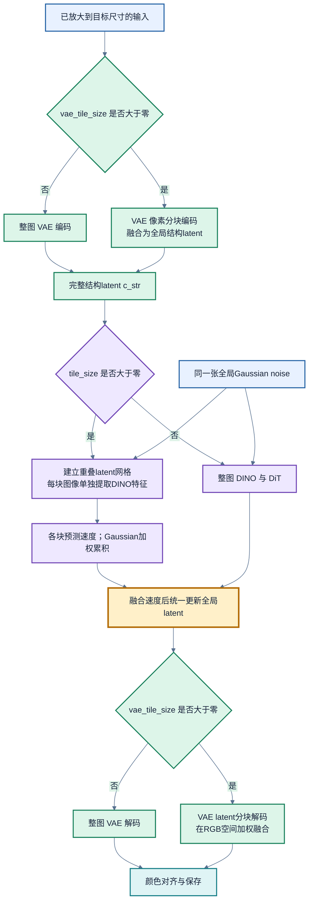

`tile_size` 决定每次 DiT 处理多大区域，同时决定 DINO 的局部视野；`vae_tile_size` 决定 VAE encode/decode 的分块大小。两者单位都以**插值后目标画布的像素**表示，但最终分别换算为 latent 坐标，不要求相等。

### 9.1 坐标换算与网格

DiT 分块在 **latent 坐标**中做，系数为 8（VAE）× 2（patch）：

```text
lt_size    = max(floor(tile_size / 8 / 2) * 2, 2)     # 512 -> 64
lt_overlap = max(floor(tile_overlap / 8), lt_size//8) # 32 -> max(4, 8) = 8
```

两个容易踩的细节：

- `lt_size` 会向下取整到 2 的倍数，保证 tile 的 latent 边长是 patch 的整数倍。
- `lt_overlap` 有 `lt_size//8` 的下限。所以 `tile_size=512` 时**实际重叠是 8 个 latent（64 像素）**，把 `--tile_overlap` 从 32 改成 16 不会进一步减小重叠；只有设到 64 像素以上才会变。

网格由 `_make_tile_grid(length, tile, overlap)` 生成：`stride = tile - overlap`，从 0 开始按 stride 排列，最后再补一个 `length - tile` 的尾部位置并去重。因此边缘 tile 可能与前一格高度重叠，但能保证完全覆盖。

```mermaid
%%{init: {"theme":"base","flowchart":{"htmlLabels":false},"themeVariables":{"background":"#FFFFFF","primaryColor":"#EAF8F0","primaryTextColor":"#14263D","primaryBorderColor":"#087F5B","secondaryColor":"#BDE8D0","secondaryTextColor":"#14263D","tertiaryColor":"#F8FAFC","tertiaryTextColor":"#14263D","lineColor":"#57708F","textColor":"#14263D","actorBkg":"#EAF8F0","actorBorder":"#087F5B","actorTextColor":"#14263D","signalColor":"#335575","fontFamily":"Arial, Noto Sans CJK SC, sans-serif","fontSize":"16px"}}}%%
flowchart LR
    A["目标画布<br/>512 × 512 像素"] --> B["VAE /8<br/>64 × 64 latent"]
    B --> C["网格步长 stride = 56<br/>重叠 8 个 latent"]
    C --> D["单个 64 × 64 tile"]
    D --> E["PatchEmbed 2 × 2<br/>1024 tokens"]
    E --> F["DiT 前向"]
    F --> G["高斯权重 g"]
    G --> H["u_acc / w_acc"]
    H --> I["全局 z ← z - Δt·u"]
    %% STYLE_START
    classDef input fill:#E8F1FF,stroke:#2563A6,stroke-width:2px,color:#17233A;
    classDef condition fill:#DDF5E9,stroke:#18805B,stroke-width:2px,color:#17233A;
    classDef model fill:#EEE8FF,stroke:#7045B5,stroke-width:2px,color:#17233A;
    classDef key fill:#FFF0C9,stroke:#B36B00,stroke-width:3px,color:#17233A;
    classDef output fill:#DFF4F5,stroke:#157D86,stroke-width:2px,color:#17233A;
    classDef warning fill:#FFE7E7,stroke:#B73B46,stroke-width:2.5px,color:#17233A;
    class A input;
    class B,C condition;
    class D,E,F,G model;
    class H key;
    class I output;
    %% STYLE_END
```

### 9.2 单步内的 tile 调度

[tiled_latent_inference](vosr_core.py#L329) 的顺序很关键：

1. 整图 VAE 编码一次（或分块编码），得到**完整** `lq_latent` 和 `latents_mean/std`；
2. 若 latent 本身不超过一个 tile，直接走快路径，不进入网格；
3. 否则预先把每个 tile 对应的**像素裁剪**送进 DINO，缓存 `tile_venc[(hi,wi)]`。DINO 只算一遍，不随采样步数重复；
4. 生成**一张全局噪声** `z`；
5. 每一步：遍历所有 tile，用**全局 z 的对应切片**作为状态输入，得到该 tile 的 `u_tile`，按高斯权重累加到 `u_acc`、`w_acc`；
6. 整张图累加完成后才 `z = z - dt * (u_acc / w_acc)`。

这意味着所有 tile 看到的是**同一个全局 latent 状态**，不会出现“各 tile 各自积分、边界漂移”的问题。噪声也是全局共享的，tile 之间只共享坐标切片，不重新采样。

因此“单步”不等于“一次网络前向”：时间维只有 1 个采样步，空间上每帧仍要走 `n_tiles` 次 DiT（例如 1440p 2× 为 6×4=24 次）。

高斯权重（[tiled_vae.py:41](tiled_vae.py#L41)）：

```text
w(y,x) = exp(-((y-cy)/tile_h)^2 / (2*0.01)) * exp(-((x-cx)/tile_w)^2 / (2*0.01))
c = (tile-1)/2
```

`var=0.01` 使权重非常尖锐：中心为 1，边缘约 `e^-12.5 ≈ 4e-6`。因此融合结果接近“以每个像素所在 tile 的中心为主”，重叠区只是用极小权重做平滑过渡；归一化 `u_acc / w_acc` 保证权重和为 1。累加缓冲区的 dtype 跟随 `lq_latent`（BF16 路径下就是 BF16），所以 BF16 与 FP32 的差异不只来自权重，也来自这里的累加舍入。

### 9.3 DINO 与 tile 的对齐

分块路径不是“整图提 DINO 再切特征”，而是**按像素 tile 重新跑 DINO**：

```python
ph_s, pw_s = hi * 8, wi * 8
ph_e = min((hi + lt_size) * 8, H)
pw_e = min((wi + lt_size) * 8, W)
z_fea_tile = get_venc_features(venc, lq_tensor[:, :, ph_s:ph_e, pw_s:pw_e], args)
```

这样做的好处是每个 DiT tile 的语义条件与它自己的感受野一致；代价是 tile 数 × 一次 DINO 前向。由于 DINO 输入固定缩放到 448×448，单个 tile 的 DINO 成本与 tile 大小无关（512 tile 和 1024 tile 都是 448 输入），所以 **tile 越小，DINO 总成本越高**。

`_crop_venc_features` 是给“整图 DINO + 切特征”路径准备的辅助函数：按 latent 坐标比例映射到 32×32 的 token 网格再裁剪。当前 `tiled_latent_inference` 走的是逐 tile 提特征，没有调用它。

### 9.4 VAE 分块

VAE 分块在 [tiled_vae.py](tiled_vae.py) 中独立实现：

- **编码**：先 reflect-pad 到 8 的倍数；按 8 对齐裁像素 tile；每个 tile 用 `latent_dist.mode()`（**不能用 `.sample()`**，否则每个 tile 独立抽随机数会产生接缝）；在 latent 空间高斯加权融合；最后裁回 `ceil(H/8) × ceil(W/8)`。
- **解码**：把 SR latent 切成重叠 tile，每个 tile 解码成 8× 的像素块，在 **RGB 空间**（3 通道）高斯融合，最后 `clamp(-1,1)`。
- 重叠默认跟随 `tile_overlap`，同样有 `lt_size//8` 下限。

因为 Qwen VAE 只用逐像素的 `RMSNorm2D`，没有 GroupNorm 这类跨 tile 统计量，所以“独立前向 + 加权融合”在数学上是成立的；这也是模块注释里明确说明不需要 LDM 那套 `VAEHook` pad/crop 机制的原因。

### 9.5 参数建议

| 参数 | 建议 | 理由 |
| --- | --- | --- |
| `tile_size` | **512** | 与训练分辨率一致；更大偏离分布、注意力成本上升；更小则上下文不足、接缝风险上升 |
| `tile_overlap` | 默认 32（实际 64 px） | 低于 16 会告警；由于 `lt_size//8` 下限，设 32 与 64 在 512 tile 下等价 |
| `vae_tile_size` | ≤1440p 用 0；4K 用 1024；仍 OOM 用 512 | 纯显存开关，画质几乎不变；分块会多次子解码+融合，略慢 |
| `batch_size` | 8；OOM 时先降到 4/2 | 直接按比例降 VAE 峰值，比开 VAE 分块改动更小 |
| `dtype` | 默认 bf16；对照实验用 fp32 | BF16 权重减半、吞吐更高 |
| `infer_steps` | 1 | VOSR2 是单步蒸馏权重 |

一个容易忽略的行为：服务在 `tile_size<=0` 且原图/帧非方形时会**自动强制 `tile_size=512`**，因为 `forward_flexible` 断言 `H==W`。CLI 整图路径则用 `SquarePadDiT` 做 reflect-pad + crop，两者不是同一套处理。


## 10. 版本迭代

`0.5B/1.4B` 是主干规模；`ms/os` 是多步教师/单步学生；`VOSR2` 是后续单步模型发布。

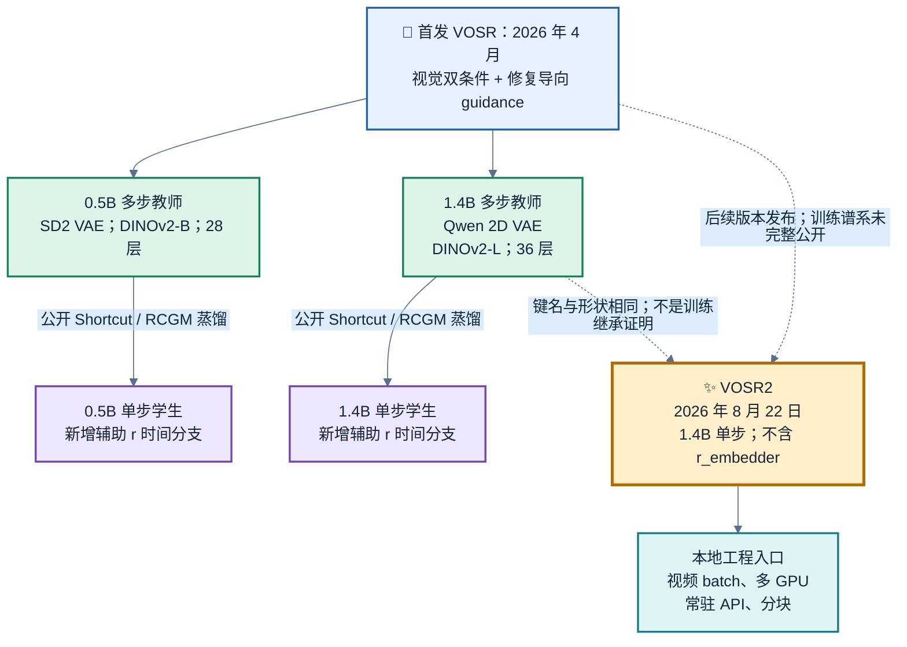

| 项目 | 首发 0.5B-ms | 首发 0.5B-os | 首发 1.4B-ms | 首发 1.4B-os | VOSR2 |
| --- | --- | --- | --- | --- | --- |
| DiT 宽度 / 深度 / heads | 1024 / 28 / 16 | 同左 | 1536 / 36 / 24 | 同左 | 1536 / 36 / 24 |
| head dimension | 64 | 64 | 64 | 64 | 64 |
| VAE / latent 通道 | SD2 / 4 | SD2 / 4 | Qwen 2D / 16 | Qwen 2D / 16 | Qwen 2D / 16 |
| 额外轻量 decoder | 有 | 有 | 无 | 无 | 无 |
| DINO / 所选 block 索引 | B / 8 | B / 8 | L / 17 | L / 17 | L / 17 |
| 结构输入与状态拼接 | 8 通道 | 8 通道 | 32 通道 | 32 通道 | 32 通道 |
| 辅助终点时间 r | 无 | 有 | 无 | 有 | 无 |
| 默认步数 | 25 | 1 | 25 | 1 | 1 |
| 采样时显式强弱 guidance | 有 | 无 | 有 | 无 | 无 |

全部型号都使用 patch size 2、QK-Norm、RMSNorm、SwiGLU、二维 RoPE 和 DINO cross-attention。512 像素区域的 latent 网格均为 64×64，DiT token 数均为 1024。1.4B 的表示扩容来自通道、宽度与深度。
